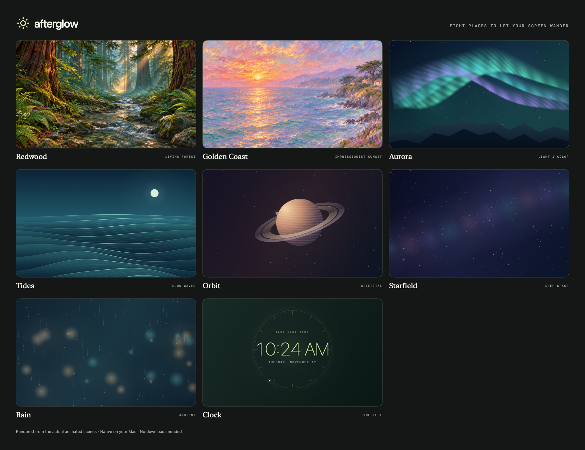

# Afterglow for Mac

**Keep your Mac awake. Give your screens somewhere to wander.**

[Download Afterglow for Mac](https://github.com/keegan-wang/afterglow-downloads/releases/latest/download/Afterglow.dmg) ·
[All releases and ZIP downloads](https://github.com/keegan-wang/afterglow-downloads/releases)

macOS 14 or later · Apple Silicon + Intel · Runs offline

**Public beta — not yet notarized by Apple.** macOS may require explicit approval
on first launch. See the installation instructions below before downloading.

## Animated scenes and video wallpapers

- **Six built-in scenes:** Aurora, Tides, Orbit, Starfield, Rain, and Clock.
- **Native video wallpapers:** add your own local MP4, MOV, or M4V to the Redwood
  or Golden Coast slot. Afterglow loops the full video on every display, with no
  photo-animation filter or particle overlay. Each slot has a poster preview;
  cinematic forest and Monet-style coastal video clips are not included yet.

Click **Start screensaver** to cover every connected display and prevent idle
sleep. Move the mouse or press a key to return to your desktop; the awake session
continues until you stop it or its timer ends. Keep the laptop lid open.

Afterglow has menu-bar controls, timed sessions, low energy animation, and support
for Reduce Motion. It has no account, analytics, network requests, or runtime
downloads. Your existing macOS lock settings remain in force; the visual
screensaver is not a password lock.

## Install

1. Download and open **Afterglow.dmg**.
2. Drag **Afterglow.app** to **Applications**.
3. Open it from Applications, choose a scene, and click **Start screensaver**.

This beta is ad-hoc signed, **not Developer ID signed or Apple notarized**. If
macOS blocks it, only proceed if you trust the download. Apple's documented
per-app approval is **System Settings → Privacy & Security → Open Anyway**, after
you first try to open the app. See [Apple's instructions](https://support.apple.com/en-us/102445).

Developer ID signing and notarization are planned for a future build. There is no
need to disable Gatekeeper or change system-wide security settings.

For updates, quit Afterglow before replacing it in Applications. Download checksums
are included as `SHA256SUMS.txt` with each release.

## Feedback

[Report a problem or request a scene](https://github.com/keegan-wang/afterglow-downloads/issues).
This repository hosts the app, artwork previews, and releases. Application source
is maintained separately.

Copyright © 2026 Keegan Wang. MIT license.
